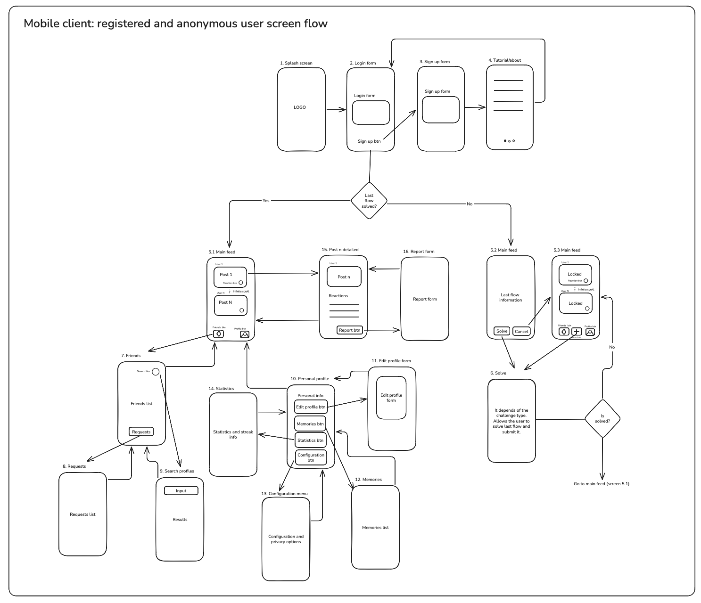
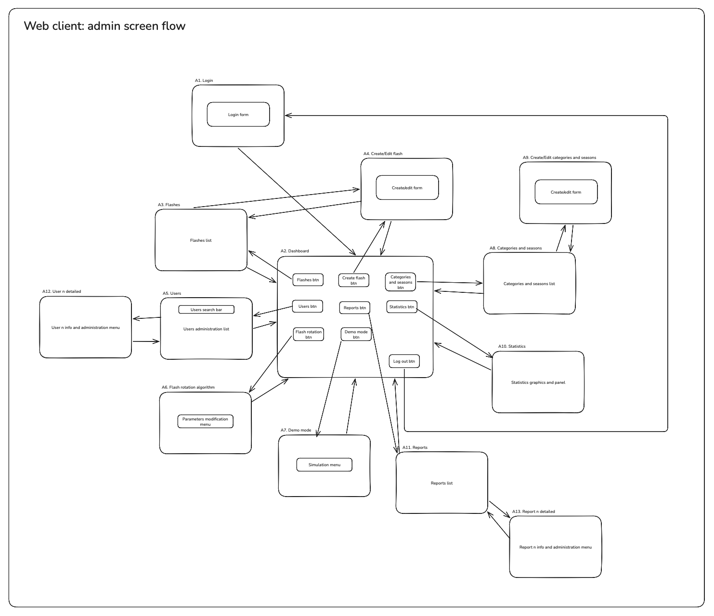

# Flashing: una red social de retos creativos con cliente web y móvil

Flashing es una red social de retos creativos cortos, denominados *flashes*. Cada día, a una hora variable, todos los usuarios reciben el mismo reto y disponen de un tiempo limitado para responder con una fotografía, un audio, un dibujo o un texto breve. Las respuestas se guardan en un historial personal y se comparten con las amistades cuando el usuario completa el flash del día. La aplicación también contará con un cliente web de administración para gestionar retos, categorías, temporadas, usuarios, moderación y estadísticas.

> **Estado del proyecto:** se ha completado la configuración tecnológica de la fase 2. La funcionalidad mínima conecta React, la API REST de Spring Boot y MySQL; muestra retos de ejemplo y dispone de pruebas automáticas, cobertura e integración continua. Las funcionalidades sociales descritas en la documentación siguen siendo objetivos y todavía no forman una aplicación completa para usuarios finales.

## Bocetos de la aplicación

### Cliente móvil



[Ver todos los bocetos y flujos de navegación](docs/ANALISIS.md#pantallas-y-navegación)

### Cliente web de administración



## Documentación

- [Objetivos](docs/OBJETIVOS.md): objetivos funcionales y técnicos del proyecto.
- [Metodología](docs/METODOLOGIA.md): fases, fechas y planificación temporal.
- [Funcionalidades detalladas](docs/FUNCIONALIDADES.md): funcionalidades básicas, intermedias y avanzadas por tipo de usuario.
- [Análisis](docs/ANALISIS.md): pantallas, navegación, entidades, permisos, imágenes, gráficos y algoritmo avanzado.
- [Seguimiento](docs/SEGUIMIENTO.md): uso de issues, pull requests, ramas y GitHub Project.
- [Guía de desarrollo](docs/DESARROLLO.md): arquitectura, tecnologías, ejecución, pruebas, cobertura, CI y uso de la API.
- [Autores](docs/AUTORES.md): autoría del proyecto.
- [Uso de herramientas de IA](docs/AI_USAGE.md): registro detallado del uso de inteligencia artificial.
- [Registro de cambios](CHANGELOG.md): cambios notables realizados en cada versión.
- [Documentación OpenAPI](https://raw.githack.com/codeurjc-students/2026-Flashing/main/docs/api/api-docs.html): representación HTML de la API REST.

## Inicio rápido

La aplicación necesita Java 21, Maven, Node.js 22.12 o superior, npm y MySQL. Las instrucciones completas están en la [guía de desarrollo](docs/DESARROLLO.md#ejecución-local).

```bash
mvn -f backend/pom.xml spring-boot:run
npm --prefix frontend install
npm --prefix frontend run dev
```

Con ambos procesos iniciados, la aplicación web está disponible en <http://localhost:5173> y la API REST en <http://localhost:8080/api/v1/challenges>.

## Calidad del proyecto

La funcionalidad mínima dispone de pruebas unitarias, de integración y de sistema para cliente y servidor. JaCoCo mide la cobertura del backend y Vitest/V8 la del frontend. GitHub Actions ejecuta un control básico en ramas de funcionalidad y un control completo en las pull requests dirigidas a `main`.

## Uso de herramientas de IA

Durante las fases 1 y 2 se han utilizado Perplexity, Gemini y Codex para explorar la viabilidad, estructurar la documentación, revisar la arquitectura, explicar e implementar pruebas y configurar cobertura e integración continua. Todas las intervenciones relevantes se detallan en [AI_USAGE.md](docs/AI_USAGE.md).

## Autor

[Isidoro Pérez Rivera](docs/AUTORES.md)
