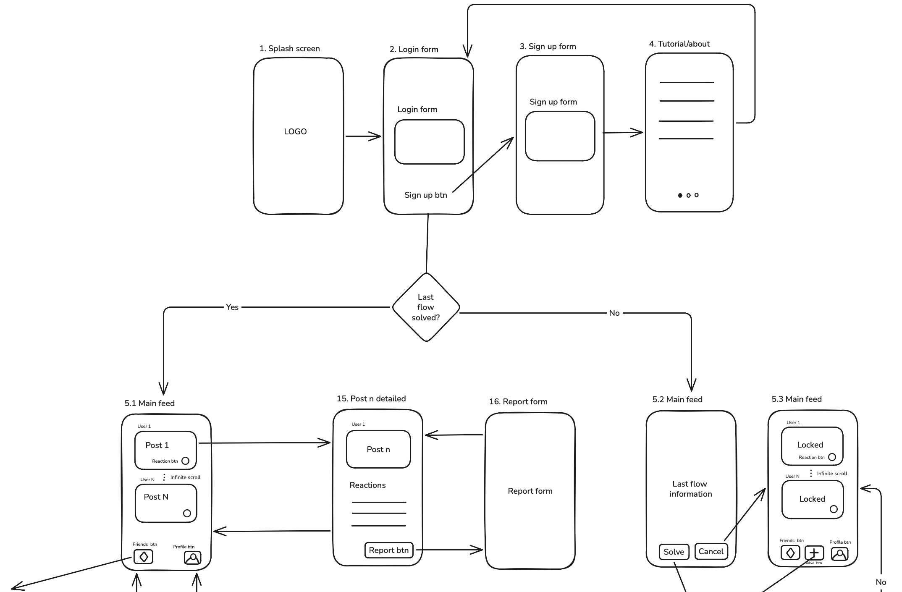
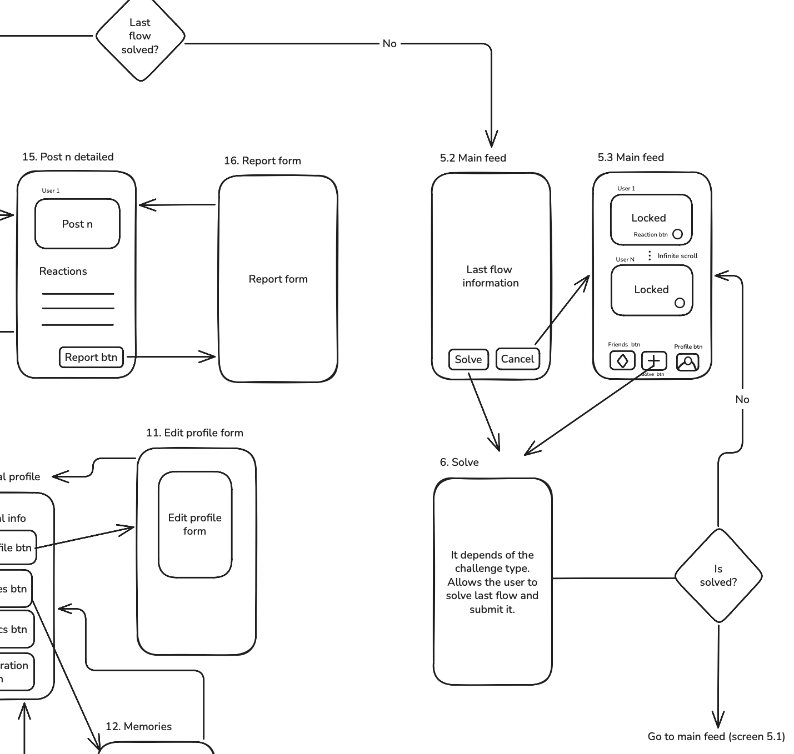
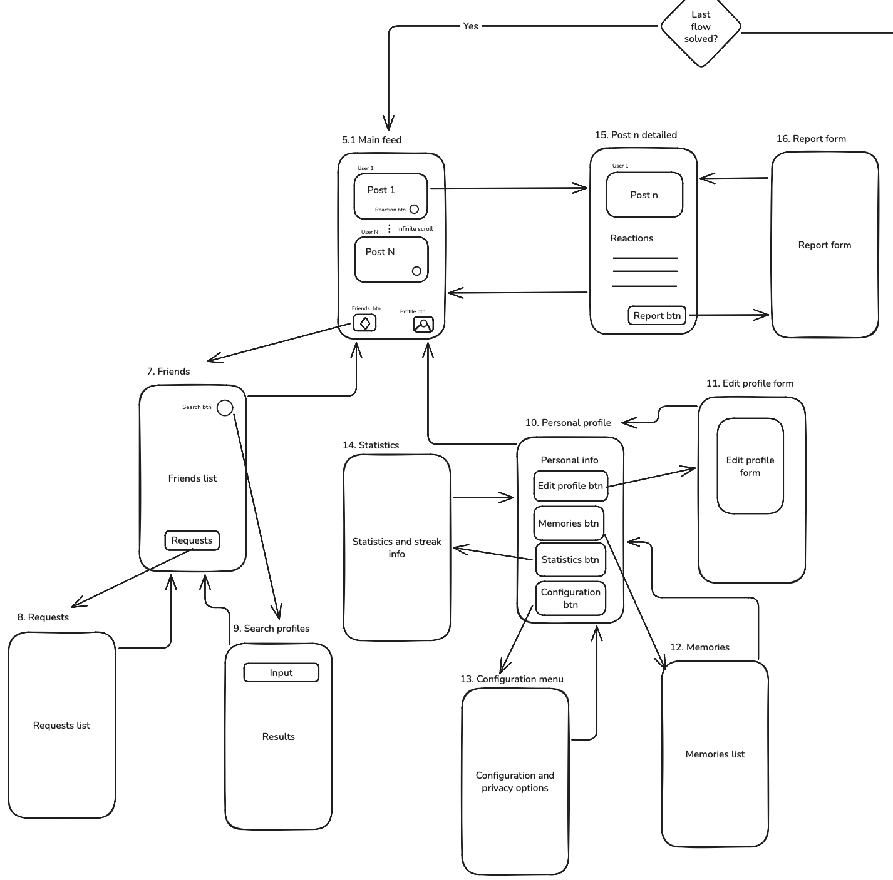
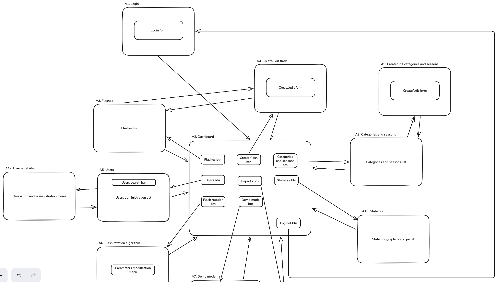
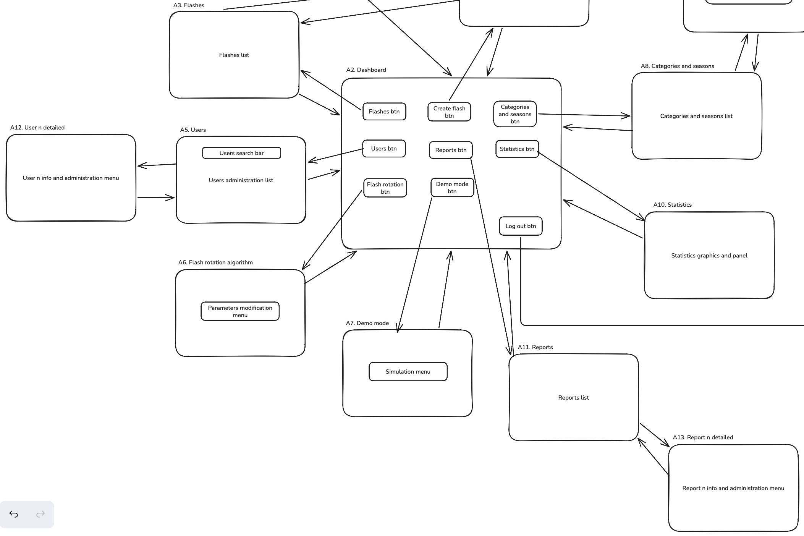

# Análisis

[Volver al índice principal](../README.md#documentación)

## Pantallas y navegación

### Cliente móvil

El cliente móvil adapta su navegación al estado de autenticación y a si el usuario ha completado el flash activo. Un usuario anónimo solo podrá acceder a las pantallas públicas, mientras que un usuario registrado podrá participar, consultar su comunidad y acceder a su historial.

### Cliente web

El cliente web estará orientado principalmente al administrador. Permitirá gestionar retos, programación, usuarios, reportes, temporadas y estadísticas.

## Entidades y atributos principales

### User

- `id`
- `username`
- `displayName`
- `email`
- `passwordHash`
- `role`: `USER` o `ADMIN`
- `avatar`
- `timezone`
- `createdAt`
- `lastLoginAt`
- `status`: `ACTIVE`, `SUSPENDED` o `DELETED`

### Challenge

Plantilla reutilizable de un reto.

- `id`
- `title`
- `prompt`
- `type`: `DOUBLE_PHOTO`, `QUICK_DRAWING`, `SHORT_AUDIO`, `GUIDED_PHOTO` o `SHORT_TEXT`
- `category`
- `difficulty`: `EASY`, `MEDIUM` o `HARD`
- `durationSeconds`
- `active`
- `season`
- `createdAt`
- `createdBy`

En la fase 2 solo están implementados `id`, `title`, `prompt`, `type` y `durationSeconds`.

### DailyFlash

Aparición concreta de un reto en una fecha.

- `id`
- `challengeId`
- `scheduledAt`
- `endsAt`
- `status`: `SCHEDULED`, `ACTIVE`, `CLOSED` o `CANCELLED`
- `timezone`
- `createdAt`

### Submission

Respuesta de un usuario a un flash.

- `id`
- `dailyFlashId`
- `userId`
- `type`
- `textContent`
- `mediaUrl`
- `submittedAt`
- `submissionStatus`: `SUBMITTED`, `VISIBLE`, `REPORTED`, `HIDDEN` o `REMOVED`
- `visibility`: `PRIVATE` o `FRIENDS`
- `isLate`
- `createdAt`

### MediaAsset

- `id`
- `submissionId`
- `type`
- `storageKey`
- `mimeType`
- `sizeBytes`
- `durationSeconds`
- `createdAt`

### Reaction

- `id`
- `submissionId`
- `userId`
- `reactionType`: `LIKE`, `LAUGH`, `WOW` o `DISLIKE`

### Friendship

- `id`
- `requesterId`
- `addresseeId`
- `status`: `PENDING`, `ACCEPTED` o `CANCELLED`
- `createdAt`
- `acceptedAt`

### Block

- `id`
- `blockerId`
- `blockedId`
- `createdAt`

### Report

- `id`
- `reporterId`
- `reportedUserId`
- `reason`: `HARASSMENT`, `HATEFUL_CONTENT`, `SEXUAL_CONTENT`, `VIOLENCE`, `SPAM`, `PRIVACY` u `OTHER`
- `status`: `PENDING`, `RESOLVED` o `DISMISSED`
- `resolution`
- `createdAt`
- `resolvedAt`

## Relaciones

- `User 1 - N Submission`: un usuario puede responder a muchos flashes.
- `Challenge 1 - N DailyFlash`: una plantilla puede utilizarse en varias fechas.
- `DailyFlash 1 - N Submission`: un flash recibe muchas respuestas, como máximo una por usuario.
- `Submission 1 - N MediaAsset`: una respuesta puede necesitar varios archivos.
- `Submission 1 - N Reaction`: una respuesta puede recibir varias reacciones.
- `User 1 - N Reaction`: un usuario puede realizar varias reacciones.
- `User 1 - N Friendship`: un usuario puede enviar y recibir solicitudes.
- `User 1 - N Block`: un usuario puede bloquear a varios usuarios y ser bloqueado.

## Permisos de usuarios

### Usuario anónimo

- Ver la página pública, explicaciones, ejemplos y normas.
- Registrarse e iniciar sesión.

### Usuario registrado

- Gestionar su perfil y privacidad.
- Consultar y responder al flash activo.
- Consultar su historial.
- Gestionar amistades y bloqueos.
- Consultar y reaccionar a respuestas permitidas.
- Reportar contenido.
- Eliminar sus datos.

### Administrador

- Gestionar retos, categorías y temporadas.
- Programar flashes.
- Consultar y moderar usuarios y contenido.
- Resolver reportes.
- Consultar gráficos globales.
- Revisar retos sugeridos por inteligencia artificial.

## Imágenes y contenido multimedia

`MediaAsset` representará imágenes y audios asociados a las respuestas. El mecanismo definitivo de almacenamiento se abordará en fases posteriores. La funcionalidad mínima de la fase 2 no incluye archivos multimedia.

## Gráficos

El panel de administración mostrará participación diaria, usuarios activos, porcentaje de respuestas a tiempo y tardías, participación por tipo de reto, popularidad de categorías, evolución de registros y tiempo medio de respuesta.

## Tecnología complementaria

Se utilizarán notificaciones *push* para avisar del flash diario, recordatorios, interacciones y solicitudes de amistad.

## Algoritmo o consulta avanzada

El algoritmo de rotación seleccionará el siguiente flash mediante criterios como retos ya utilizados, tiempo desde la última aparición de cada categoría, formatos recientes, dificultad, duración y temporada. Su objetivo será mantener variedad y evitar repeticiones predecibles.
