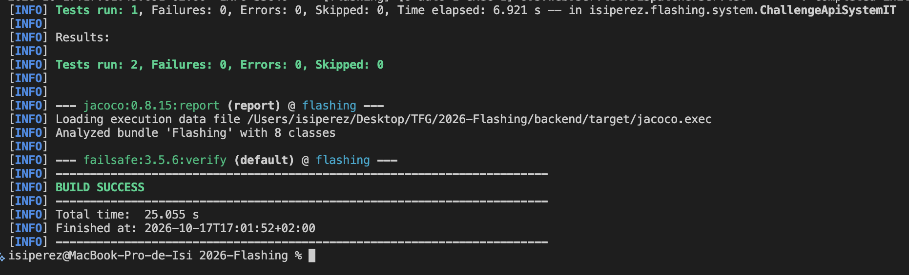
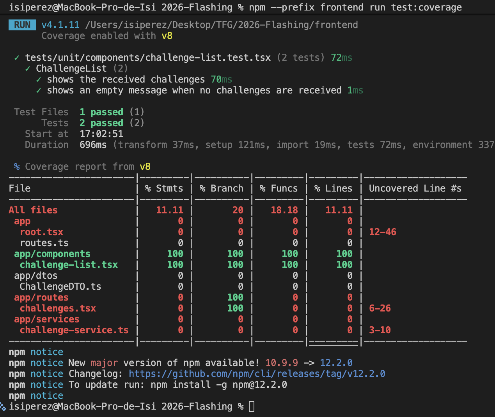
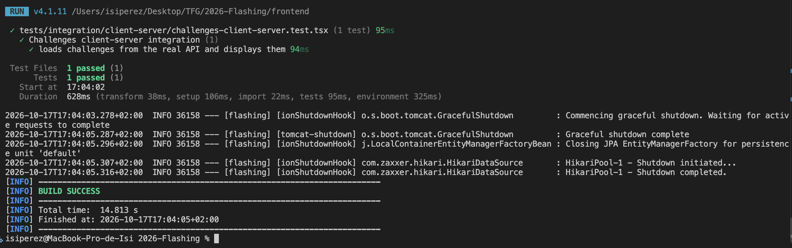
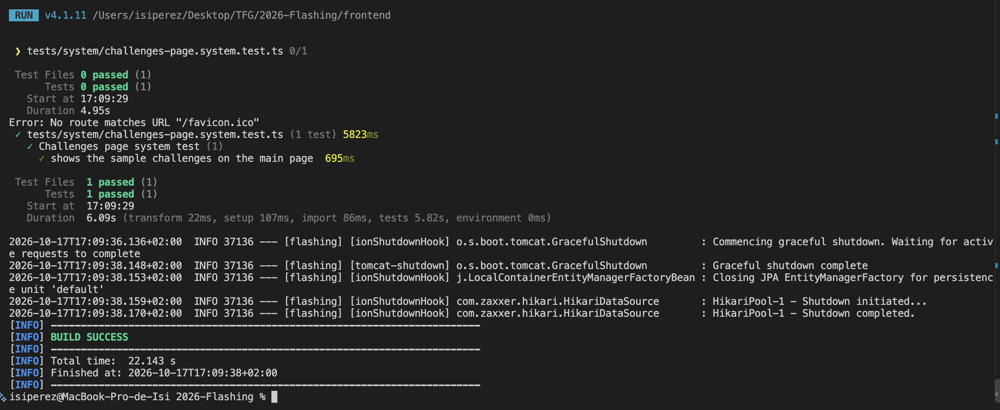
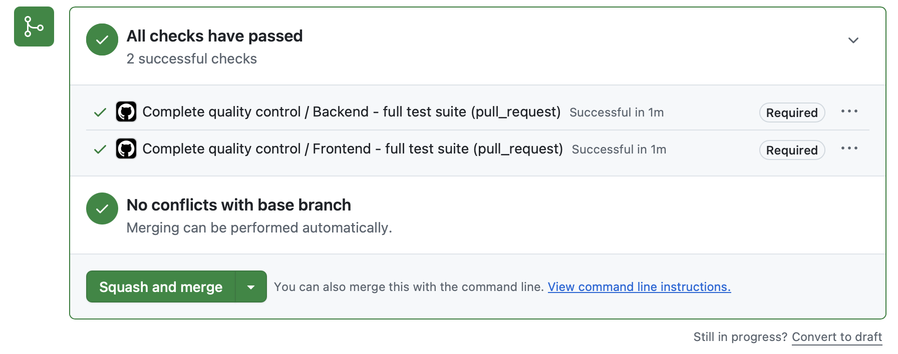

# Guía de desarrollo

[Volver al índice principal](../README.md#documentación)

## Índice

- [Introducción](#introducción)
- [Resumen técnico](#resumen-técnico)
- [Tecnologías](#tecnologías)
- [Herramientas](#herramientas)
- [Arquitectura](#arquitectura)
- [Control de calidad](#control-de-calidad)
- [Proceso de desarrollo](#proceso-de-desarrollo)
- [Ejecución local](#ejecución-local)
- [Uso de la API REST](#uso-de-la-api-rest)
- [Ejecución de pruebas](#ejecución-de-pruebas)
- [Creación de una release](#creación-de-una-release)

## Introducción

Flashing utiliza actualmente una arquitectura web SPA formada por tres procesos independientes: un cliente React ejecutado en el navegador, una API REST desarrollada con Spring Boot y una base de datos MySQL. Una SPA carga una aplicación JavaScript y actualiza su contenido sin solicitar al servidor un documento HTML completo para cada interacción.

El cliente llama a la API mediante HTTP y recibe representaciones JSON. La API aplica la lógica de negocio y accede a MySQL mediante Spring Data JPA. Durante el desarrollo, Vite sirve el cliente y reenvía las rutas `/api` al backend.

La fase 2 implementa una funcionalidad mínima: recuperar plantillas de reto almacenadas en MySQL y mostrarlas en la página principal. El cliente móvil con React Native y Expo se incorporará en una fase posterior.

## Resumen técnico

| Aspecto | Estado de la fase 2 |
| --- | --- |
| Tipo | Web SPA y API REST por capas |
| Cliente | React 19, TypeScript, React Router y Vite |
| Servidor | Java 21, Spring Boot 4, Spring MVC y Spring Data JPA |
| Base de datos | MySQL |
| Comunicación | HTTP y JSON; proxy `/api` de Vite en desarrollo |
| Documentación API | OpenAPI 3.1 y HTML estático |
| Pruebas | JUnit, Mockito, Vitest, Testing Library, Testcontainers, Rest Assured y Selenium |
| Cobertura | JaCoCo en backend y Vitest/V8 en frontend |
| Integración continua | GitHub Actions con controles básico y completo |
| Despliegue | Ejecución local; Docker se abordará en la fase 3 |
| Proceso | Iterativo e incremental, issues, ramas y pull requests |

## Tecnologías

### Java 21

Lenguaje utilizado en el backend. La versión LTS 21 es la versión configurada tanto en Maven como en GitHub Actions. [Sitio oficial](https://www.oracle.com/java/technologies/downloads/#java21)

### Spring Boot

Proporciona la configuración y el ciclo de vida del backend. Spring MVC expone la API REST y Spring Data JPA implementa el acceso a datos. [Sitio oficial](https://spring.io/projects/spring-boot)

### MySQL

Sistema relacional que almacena las entidades. En las pruebas de integración y sistema se inicia una instancia real y desechable mediante Testcontainers. [Sitio oficial](https://www.mysql.com/)

### MapStruct

Genera el código de conversión entre entidades JPA y DTO durante la compilación. [Sitio oficial](https://mapstruct.org/)

### React y TypeScript

React construye la interfaz web mediante componentes y TypeScript añade tipos estáticos al código JavaScript. [React](https://react.dev/) · [TypeScript](https://www.typescriptlang.org/)

### React Router

Gestiona las rutas, la carga de datos y los límites de error del cliente web. El proyecto usa Framework Mode con renderizado del lado del cliente. [Sitio oficial](https://reactrouter.com/)

### Vite

Proporciona el servidor de desarrollo, la compilación del frontend y el proxy local hacia la API. [Sitio oficial](https://vite.dev/)

### OpenAPI

Describe de forma interoperable las operaciones y los esquemas de la API REST. [Sitio oficial](https://www.openapis.org/)

## Herramientas

### Visual Studio Code

Visual Studio Code es el editor utilizado para consultar y modificar el código. El backend y el frontend se abren desde la carpeta raíz del repositorio y sus comandos principales se ejecutan desde la terminal integrada. No es necesario depender de botones o extensiones específicas del editor, por lo que las mismas instrucciones pueden reproducirse en cualquier terminal. [Sitio oficial](https://code.visualstudio.com/)

### Maven y npm

Maven compila y verifica el backend; npm instala dependencias y ejecuta scripts del frontend. [Maven](https://maven.apache.org/) · [npm](https://www.npmjs.com/)

### Git y GitHub

Git mantiene el historial local. GitHub aloja el repositorio, issues, pull requests, proyecto y workflows. [Git](https://git-scm.com/) · [GitHub](https://github.com/)

### GitHub Actions

Ejecuta los controles automáticos de compilación y pruebas en cada cambio relevante. [Sitio oficial](https://github.com/features/actions)

### Testcontainers

Crea contenedores efímeros de MySQL para que las pruebas utilicen el mismo motor que la aplicación. Requiere Docker en la máquina que ejecuta las pruebas. [Sitio oficial](https://testcontainers.com/)

### Postman

Permite importar la colección incluida en el repositorio y realizar peticiones manuales a la API. [Sitio oficial](https://www.postman.com/)

## Arquitectura

### Despliegue local

```text
Navegador
  │
  │ HTTP :5173
  ▼
React + React Router + Vite
  │
  │ /api → HTTP :8080
  ▼
Spring Boot REST API
  │
  │ JDBC :3306
  ▼
MySQL
```

El backend mantiene una arquitectura por capas:

```text
ChallengeRestController
        ↓
ChallengeService
        ↓
ChallengeRepository
        ↓
MySQL
```

- El controlador recibe solicitudes HTTP y devuelve DTO.
- El servicio contiene la lógica de negocio.
- El repositorio encapsula el acceso a datos.
- `ChallengeMapper` convierte entidades en `ChallengeDTO`.
- `DatabaseInitializer` añade tres retos cuando la tabla está vacía.

### API REST

La operación implementada es:

```http
GET /api/v1/challenges
```

Devuelve una lista JSON ordenada por identificador. La documentación está disponible en:

- [Especificación OpenAPI](api/api-docs.yaml)
- [Documentación HTML mediante RawGitHack](https://raw.githack.com/codeurjc-students/2026-Flashing/main/docs/api/api-docs.html)

## Control de calidad

### Trazabilidad de pruebas

| Nivel | Servidor | Cliente | Funcionalidad verificada |
| --- | --- | --- | --- |
| Unitaria | `ChallengeServiceTest` | `challenge-list.test.tsx` | El servicio devuelve DTO y el componente muestra la lista o el estado vacío |
| Integración | `ChallengeServiceIT` | `challenges-client-server.test.tsx` | Servicio-repositorio-MySQL y componente-API real |
| Sistema | `ChallengeApiSystemIT` | `challenges-page.system.test.ts` | API REST completa y página real abierta con Selenium |

La fase 2 contiene tres casos de prueba en el backend y cuatro en el frontend.

### Cobertura

`mvn verify` genera el informe JaCoCo en `backend/target/site/jacoco/index.html`.

| Métrica backend | Cobertura de fase 2 |
| --- | ---: |
| Instrucciones | 96,40 % |
| Líneas | 93,10 % |
| Métodos | 95,00 % |
| Ramas | 62,50 % |

`npm run test:coverage` genera el informe V8 en `frontend/coverage/index.html`.

| Métrica frontend | Cobertura de fase 2 |
| --- | ---: |
| Líneas | 11,11 % |
| Funciones | 18,18 % |
| Ramas | 20,00 % |

La cobertura del cliente incluye todos los archivos de `app`, incluso los que todavía no tienen pruebas unitarias. Los informes generados se excluyen de Git porque se pueden regenerar.

### Evidencias de ejecución

La suite completa del backend ejecuta las pruebas unitarias, de integración y de sistema mediante Maven. El resultado siguiente muestra los casos completados sin fallos ni errores, la generación del informe JaCoCo y la finalización correcta de la construcción:



Las pruebas unitarias del frontend verifican los estados con datos y sin retos del componente `ChallengeList`. Vitest muestra los dos casos superados y el resumen de cobertura generado mediante V8:



La prueba de integración cliente-servidor arranca la API REST real, recupera los retos desde ella y comprueba que el componente los representa. La captura muestra tanto el caso superado como el cierre correcto del backend:



La prueba de sistema del cliente abre la aplicación mediante Selenium y comprueba que los retos de ejemplo aparecen en la página principal. El resultado muestra el caso superado, el cierre limpio de los procesos y la construcción completada correctamente:



### Integración continua

El workflow **Basic quality control** se ejecuta en cada `push` a ramas `feature/**` y `fix/**`:

- Backend: configura Java 21, compila y ejecuta las pruebas unitarias.
- Frontend: configura Node.js 22, instala con `npm ci`, comprueba tipos, construye y ejecuta pruebas unitarias.

El workflow **Complete quality control** se ejecuta en pull requests dirigidas a `main`:

- Backend: ejecuta `mvn verify`, incluidas pruebas unitarias, de integración, de sistema y cobertura.
- Frontend: comprueba tipos, construye y ejecuta pruebas unitarias con cobertura, integración cliente-servidor y sistema con Selenium.

Ambos workflows también admiten ejecución manual mediante `workflow_dispatch`. La rama `main` está destinada a exigir que los jobs completos terminen correctamente antes del merge.

La siguiente evidencia corresponde a una pull request dirigida a `main`. Los jobs completos del backend y del frontend finalizaron correctamente, GitHub los identificó como controles obligatorios y confirmó que no existían conflictos con la rama base:



## Proceso de desarrollo

Cada cambio parte de un issue con criterios de aceptación. Se crea una rama `feature/*`, `fix/*` o `docs/*`, se realizan commits pequeños y se publica una pull request que enlaza el issue mediante `Closes #N`.

El desarrollo es iterativo e incremental y se apoya en prácticas de pruebas, revisión e integración continua. La organización visual de tareas y la estrategia de ramas se describen en [Seguimiento](SEGUIMIENTO.md).

## Ejecución local

### 1. Clonar el repositorio

```bash
git clone https://github.com/codeurjc-students/2026-Flashing.git
cd 2026-Flashing
```

### 2. Requisitos

- Java 21 y Maven.
- Node.js 22.12 o superior y npm.
- MySQL para la ejecución normal.
- Docker Desktop para las pruebas basadas en Testcontainers.
- Google Chrome para la prueba Selenium del cliente.

El fichero `.nvmrc` indica la versión principal de Node utilizada.

### 3. Preparar MySQL

Los valores predeterminados coinciden con `.env.example`:

```sql
CREATE DATABASE flashing;
CREATE USER 'flashing'@'localhost' IDENTIFIED BY 'flashing_local';
GRANT ALL PRIVILEGES ON flashing.* TO 'flashing'@'localhost';
```

La aplicación importa opcionalmente un `.env` en la raíz. Este fichero no se publica.

| Variable | Valor predeterminado |
| --- | --- |
| `DB_HOST` | `127.0.0.1` |
| `DB_PORT` | `3306` |
| `DB_NAME` | `flashing` |
| `DB_USERNAME` | `flashing` |
| `DB_PASSWORD` | `flashing_local` |
| `DB_URL` | URL JDBC formada con los valores anteriores |
| `SERVER_PORT` | `8080` |

Hibernate usa `spring.jpa.hibernate.ddl-auto=update` durante esta fase. Las migraciones controladas se valorarán cuando el modelo esté más estable.

### 4. Ejecutar el backend

En macOS, selecciona Java 21 si tienes varias versiones instaladas:

```bash
export JAVA_HOME=$(/usr/libexec/java_home -v 21)
```

Desde la raíz:

```bash
mvn -f backend/pom.xml spring-boot:run
```

La API queda disponible en <http://localhost:8080/api/v1/challenges>.

### 5. Ejecutar el frontend

En otra terminal:

```bash
npm --prefix frontend ci
npm --prefix frontend run dev
```

Abre <http://localhost:5173>. Vite reenvía las peticiones `/api` al backend del puerto 8080.

## Uso de la API REST

Con el backend iniciado, puede consultarse la operación actual mediante:

```bash
curl http://localhost:8080/api/v1/challenges
```

También puede importarse en Postman la colección [Flashing API](api/flashing-postman-collection.json). La variable `baseUrl` utiliza inicialmente `http://localhost:8080`.

## Ejecución de pruebas

### Backend

Pruebas unitarias:

```bash
mvn -f backend/pom.xml test
```

Suite completa y cobertura:

```bash
mvn -f backend/pom.xml verify
```

Docker debe estar iniciado para las pruebas de integración y sistema.

### Frontend

Instalación reproducible, tipos, build y pruebas unitarias:

```bash
npm --prefix frontend ci
npm --prefix frontend run typecheck
npm --prefix frontend run build
npm --prefix frontend test
```

Cobertura unitaria:

```bash
npm --prefix frontend run test:coverage
```

Integración cliente-servidor:

```bash
npm --prefix frontend run test:integration:client-server
```

Sistema completo con Selenium:

```bash
npm --prefix frontend run test:system
```

Las dos últimas órdenes arrancan el backend de pruebas y MySQL mediante Testcontainers. La prueba de sistema también arranca el frontend y utiliza Chrome sin interfaz gráfica.

### Incorporación de nuevas pruebas

La estructura y los comandos actuales permiten ampliar las pruebas a medida que se añadan funcionalidades:

- Las pruebas unitarias del backend se guardan en `backend/src/test/java`, conservan el paquete de la clase probada y terminan en `Test`. Maven las detecta automáticamente al ejecutar `mvn test` o `mvn verify`.
- Las pruebas de integración y de sistema del backend se guardan en el mismo árbol de pruebas y terminan en `IT`. Maven Failsafe las incorpora automáticamente a `mvn verify`. Las pruebas que necesiten MySQL pueden reutilizar la configuración de Testcontainers.
- Las pruebas unitarias del frontend se guardan en `frontend/tests/unit`. El script `npm test` ejecuta todos los archivos de prueba contenidos en esa carpeta.
- Las pruebas de integración cliente-servidor se guardan en `frontend/tests/integration/client-server` y se ejecutan con `npm run test:integration:client-server`.
- Las pruebas de sistema del cliente se guardan en `frontend/tests/system` y se ejecutan con `npm run test:system`.

Los workflows no enumeran casos de prueba individuales: llaman a Maven y a los scripts de npm. Por ello, los nuevos tests que respeten estos nombres y carpetas se incorporarán automáticamente al control correspondiente sin tener que editar GitHub Actions en cada ocasión.

## Creación de una release

Las releases funcionales comienzan en la fase 3. Antes de publicar una versión se deberá:

1. Asegurar que `main` está actualizada y todos los controles pasan.
2. Actualizar las versiones del backend y frontend de forma coherente.
3. Trasladar los cambios de `[Sin publicar]` a una sección versionada de `CHANGELOG.md`.
4. Crear una etiqueta Git con versionado semántico, por ejemplo `v0.1.0`.
5. Crear la GitHub Release asociada a la etiqueta e incluir las notas del changelog.
6. Verificar los artefactos y workflows de publicación definidos para esa fase.

No debe crearse una release de la fase 2 porque su objetivo es preparar la base técnica, no publicar una versión funcional.
