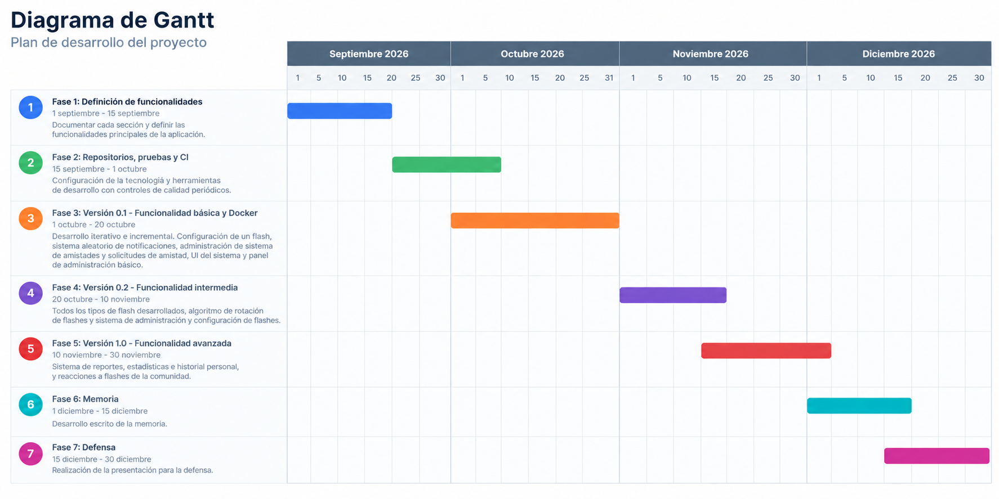

# Metodología

[Volver al índice principal](../README.md#documentación)

El trabajo se desarrolla de manera iterativa e incremental. Cada cambio se registra como una tarea, se implementa en una rama independiente y se integra en `main` mediante una pull request. Las pruebas automáticas y GitHub Actions permiten detectar regresiones antes de incorporar los cambios.

No se aplica Scrum: el proceso se apoya en principios ágiles, prácticas de Programación Extrema relacionadas con pruebas e integración continua y una gestión visual de tareas inspirada en Kanban.

## Fases

1. **Fase 1 - Definición de funcionalidades (1-15 de septiembre de 2026):** definición de objetivos, funcionalidades, pantallas, entidades, permisos y planificación.
2. **Fase 2 - Repositorio, pruebas y CI (15 de septiembre-1 de octubre de 2026):** configuración de tecnologías, funcionalidad mínima, pruebas automáticas, cobertura e integración continua.
3. **Fase 3 - Versión 0.1, funcionalidad básica y Docker (1-20 de octubre de 2026):** primer incremento utilizable, seguridad, interfaz básica y empaquetado.
4. **Fase 4 - Versión 0.2, funcionalidad intermedia (20 de octubre-10 de noviembre de 2026):** tipos de flash restantes, rotación y administración avanzada.
5. **Fase 5 - Versión 1.0, funcionalidad avanzada (10-30 de noviembre de 2026):** reportes, estadísticas, historial y reacciones.
6. **Fase 6 - Memoria (1-15 de diciembre de 2026):** redacción y revisión de la memoria.
7. **Fase 7 - Defensa (15-30 de diciembre de 2026):** preparación de la presentación y defensa.

## Diagrama de Gantt

